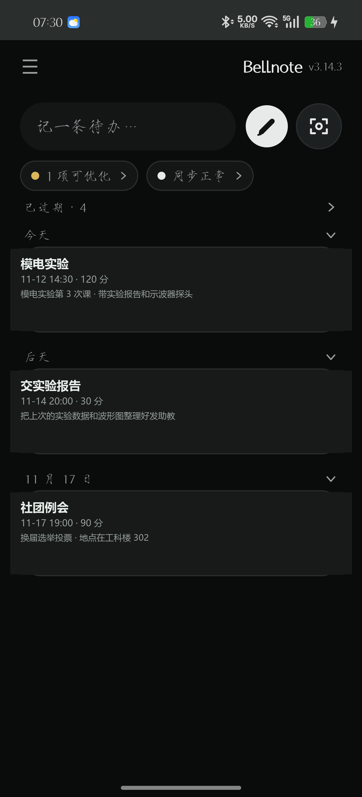
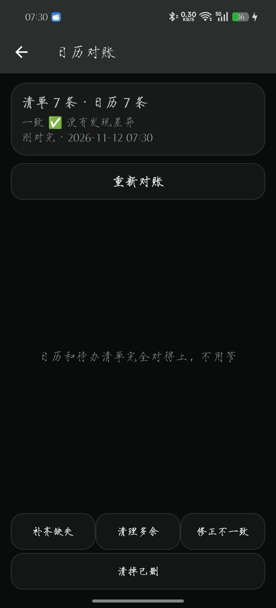
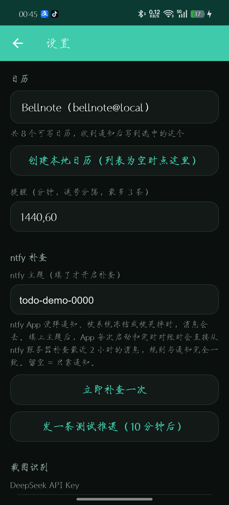

# Bellnote

**Turn ntfy notifications into calendar events — automatically, on-device.**

Bellnote is a tiny Android app (no Google services required) that listens to notifications from the
[ntfy](https://ntfy.sh) client (`io.heckel.ntfy`), parses the message text, and writes it into your
system calendar with two reminders. You can also create, edit, and delete todos from a local UI, or
import them from a screenshot with a vision model.

[中文说明](#中文说明) · [LICENSE: MIT](LICENSE)

| Todos | Reconcile | Settings |
| --- | --- | --- |
|  |  |  |

## Why

If you already push reminders through ntfy (scripts, cron jobs, another assistant), this app turns
those pushes into real calendar entries — with alarms, recurrence, and no cloud account. It also
works on ROMs without Google Play Services (tested on realme UI 6).

## Features

- **Notification → calendar**: listens to `io.heckel.ntfy`, parses the body, writes a
  `CalendarContract.Events` row plus reminders (default: 1 day and 1 hour before).
- **One notification, many todos**: JSON array, `{"todos":[…]}` wrapper, or blank-line separated blocks.
- **Remote delete**: send `{"action":"delete","title":"…"}` and the matching event is removed.
- **Screenshot import** (optional): pick an image, compress it, send to a vision model, review in the
  edit screen, then save. Needs your own API key. The prompt is tuned so the model returns a *short*
  title (≤16 chars, verb + object), infers the duration from the chat (「2 小时」→120, 14:30-16:00 →90),
  and puts everything else — dates, places, requirements, deadlines — into the note. The current date
  is injected into the prompt so relative words like “明天” resolve to a real date instead of a guess.
- **One screenshot, several todos**: the model returns a JSON array, so a chat that mentions both
  “tomorrow's class” and “hand in the workbook before Friday” yields two separate events. One item
  goes straight to the edit screen; several are listed in a confirm dialog and written in one go.
- **Local calendar creation**: if the device has no writable calendar (common on GMS-less ROMs),
  one tap creates a local calendar via `ACCOUNT_TYPE_LOCAL`.
- **Manual add / edit / delete** with date, time, duration, repeat rule, note.
- **Scheduled reconcile**: every 30 minutes (configurable) the app compares its local todo ledger
  against the calendar and reports what is **missing**, **removed**, **extra**, or **changed**. You
  fix it with one tap — nothing is auto-deleted or auto-rewritten. Also runs on app launch and after boot.
- **Manual deletions are respected**: if you delete a Bellnote event in the system calendar yourself,
  reconcile lists it under *removed* (grey) instead of *missing*, and one tap drops it from the ledger
  for good — the app will not try to put it back.
- **No duplicate events**: the same title + start time is never written twice, so ntfy retries or
  reconnects cannot pile up copies.
- **Grouped list**: the home screen groups todos by 今天 / 明天 / 后天 / 已过期 / date.
- **Strict by default**: only messages with a parseable time become events. Random ntfy traffic is
  ignored rather than stuffed into the calendar at *now + 1 hour* (switchable in Settings).

## Message protocol

Send from any ntfy client or `curl` (`POST https://ntfy.sh/<topic>` with the body below).

**Create one todo**

```json
{"title":"Math homework","time":"2026-11-08 19:00","duration":90,"note":"Chapter 3","repeat":"weekly"}
```

- `title` — required, ≤ 30 chars
- `time` — `yyyy-MM-dd HH:mm`, local time, must be in the future
- `duration` — integer minutes (5–1440), default 60
- `note` — optional
- `repeat` — `none` / `daily` / `weekly` / `monthly` / `yearly`

**Create several todos** — JSON array, or `{"todos":[…]}`.

**Delete**

```json
{"action":"delete","title":"Math homework","time":"2026-11-08 19:00"}
```

Plain text form also works: `删除：Math homework`. Only events written by Bellnote can be deleted;
title must match exactly; without `time`, every same-titled event is deleted.

Key-value text (`标题：…` / `时间：…`) is accepted as a fallback.

**Strict by default.** Only messages whose *time* can actually be parsed become calendar events.
Anything that does not look like a todo — a plain chat message, a build notification, a script's
status text — is ignored instead of being dumped an hour from now. Turn this off in Settings
(“只收带时间的待办”) if you want the old behaviour, where every unparseable message became a todo at
*now + 1 hour*.

## How it works

| Piece | What it does |
| --- | --- |
| `service/NtfyNotificationListener` | `NotificationListenerService` filtered to `io.heckel.ntfy` |
| `parser/TodoParser` | JSON + key-value parsing, `parseAll` for multiple todos, `parseCommand` for delete |
| `parser/MiniJson` | ~200-line JSON reader (so parsing is unit-testable on the JVM) |
| `data/CalendarRepository` | insert / update / delete events and reminders, marker-based query |
| `data/TodoStore` | local SQLite ledger of every todo ntfy asked for — the source of truth for reconcile |
| `data/Reconciler` | diff engine: local ledger vs calendar → missing / extra / changed (pure function, unit-tested) |
| `service/ReconcileScheduler` | `AlarmManager` self-rescheduling timer — no WorkManager dependency |
| `ai/VisionExtractor` | screenshot → JSON via a vision model (optional) |

Events are tagged with `ORGANIZER = bellnote@local` and `[bellnote]` in the description, so the app
can list only its own entries and never touch your other calendars.

## Build

Requirements: JDK 17, Android SDK 34.

```bash
./gradlew assembleDebug          # macOS / Linux
gradlew.bat assembleDebug        # Windows
```

On Windows, `build.cmd` wraps the Gradle call and prints the APK path
(`build.cmd`, `build.cmd testDebugUnitTest`).

APK output: `app/build/outputs/apk/debug/app-debug.apk` (debug-signed; sideload it).

### Signing

`keystore/bellnote-debug.keystore` is the standard Android **debug** key, committed on purpose so
that every build — locally or on GitHub Actions — carries the same signature and existing users can
upgrade in place. It is not a secret and has no value outside this app. If you fork this and ship to
other people, generate your own release key instead.

### Automated release

`.github/workflows/release.yml` builds and publishes on every `v*` tag push (and can be run manually
from the Actions tab for an existing tag):

```bash
git tag -a v2.3 -m "Bellnote v2.3"
git push origin main
git push origin v2.3
```

The workflow runs the unit tests, builds the release APK, renames it `bellnote-<version>.apk`, and
attaches it to the GitHub Release for that tag.

## Install

1. Install the APK (allow “install unknown apps”).
2. Grant **calendar** permission on first save.
3. Enable **notification access**: Settings → Apps → Special app access → Notification access.
   If the listener never connects, open the app once and toggle the permission off/on — some ROMs
   only bind the service when the app process is alive.
4. Pick a target calendar in Settings (create a local one with the button if the list is empty).
5. Optional: set an API key for screenshot import.
6. Optional: tune scheduled reconcile (on by default, every 30 minutes) in Settings.

### realme / ColorOS notes

- No built-in “new local calendar” entry — use the app’s **Create local calendar** button.
- Add the app (and the ntfy client) to battery whitelist / auto-start so the listener survives.
- The desktop calendar card shows *today’s timeline* only, not all upcoming todos.

## Privacy

- No analytics, no ads, no telemetry. Everything stays on the device.
- The only network call is the optional screenshot import to the endpoint you configure.
- Your API key is stored in the app’s private SharedPreferences.

## Limitations

- Recurring events are edited/deleted as a whole series (no “this occurrence only” yet).
- Deleting from a push is not undoable.
- “Removed” only covers events the app remembers writing. If the ledger was reset, a hand-deleted
  event cannot be told apart from one that never made it into the calendar.
- Some vendor calendars reject `ORGANIZER`; the description marker is used as a fallback.

## License

MIT — see [LICENSE](LICENSE).

---

## 中文说明

**Bellnote** 把 ntfy 推送变成系统日历里的待办，全程在本机完成，不需要 Google 服务。

- 监听 `io.heckel.ntfy` 的通知，解析正文后写入 `CalendarContract`，自动加两条提醒（默认提前 1 天 + 1 小时）
- 一条通知可以写多条待办（JSON 数组 / `{"todos":[…]}` / 空行分段）
- 发 `{"action":"delete","title":"…"}` 或「删除：标题」即可远程删待办（只删本 App 写的）
- 截图识别（可选）：截图 → 压缩 → 视觉模型 → 编辑页确认后入日历，需要自己的 API Key
  - 标题只取**简略的一件事**（≤16 字，动词＋对象），不会把整段聊天塞进去
  - 时长从截图推断（「2 小时」→120 分钟，`14:30-16:00` →90 分钟，没线索才用 60）
  - 其余信息（具体日期、地点、要带的东西、截止时间）全部进备注
  - prompt 里注入了「现在是几点」，所以「明天 / 周五」会算成真实日期，不会瞎编年份
  - **一张截图可以出多条**：模型返回 JSON 数组，聊天里既有「明天的课」又有「周五前交作业」就出两条；
    一条直接进编辑页，多条先弹确认框，点「全部写入」一起进日历
- 设备没有可写日历时，一键创建 `ACCOUNT_TYPE_LOCAL` 本地日历
- 手动添加 / 编辑 / 删除，支持重复规则
- 定时对账（默认 30 分钟，可改）：本地清单 vs 日历，报「缺 / 已删 / 多 / 不一致」，你点一下才修复，
  从不自动删或自动改写；升级到 2.2 首次运行会把日历里现有待办收进本地清单当基线
- 你在系统日历里**手动删掉**的 Bellnote 待办会被认成「已删」（灰色），点一下就清出清单，
  不会被当成「缺失」反复提醒你补回去
- 同标题同时间不会重复写入，ntfy 重发 / 重连也不会多出一条
- 主页按「今天 / 明天 / 后天 / 已过期 / 具体日期」分组显示
- **默认严格**：只有能解析出时间的消息才写进日历，认不出格式的通知直接忽略，
  不会再按「当前时间 +1 小时」塞进去（设置里「只收带时间的待办」可以关掉，恢复旧行为）

构建：`gradlew.bat assembleDebug`（JDK 17 + SDK 34），Windows 上可直接跑 `build.cmd`。
协议、安装步骤、realme 适配见上方英文小节，中文细节在 `docs/` 里。

签名：仓库里 `keystore/bellnote-debug.keystore` 是标准 Android debug key，**故意提交**的，
这样本地构建和 GitHub Actions 产出的 APK 签名一致，已安装用户可以直接覆盖升级。它不是密钥，
对外没有价值；如果你要 fork 后分发给别人，请换成自己的正式签名密钥。

自动发版：推 `v*` tag 就会触发 `.github/workflows/release.yml`，跑单测 → 构建 → 把
`bellnote-<版本>.apk` 挂到对应 Release 上。

隐私：不收集任何数据；唯一联网是可选截图识别。

协议：MIT。
