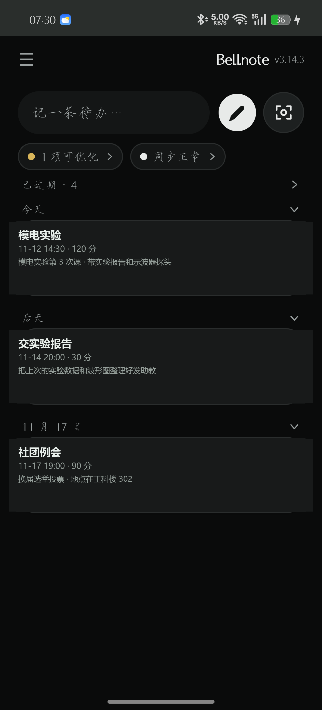
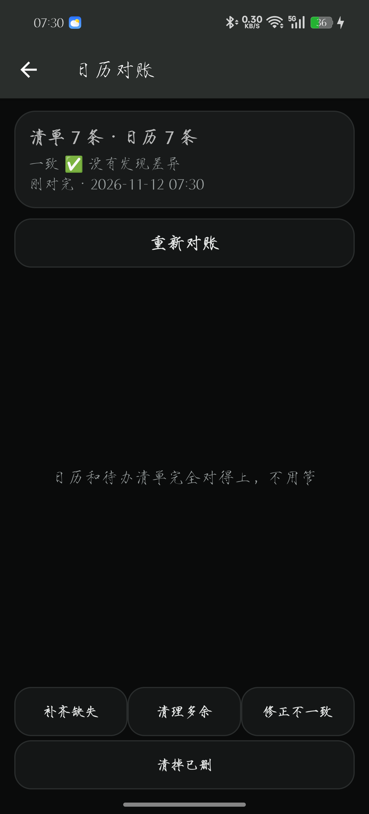
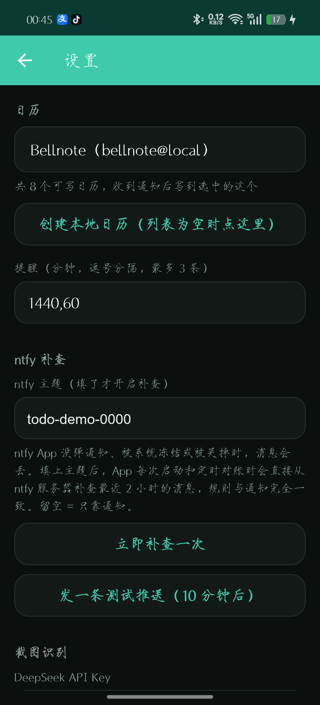

# Bellnote

**Screenshot → calendar todo: one sentence or one image, written into your calendar automatically.**

Bellnote is a small Android app (works without Google services) that turns a chat screenshot or a typed
sentence into a real calendar event with reminders. A vision model reads the screenshot, splits the chat
into every separate task, and lets you review before saving. [ntfy](https://ntfy.sh) is supported as an
optional input source: if you already push reminders through it, the app polls your topic over HTTP and
writes those messages into the calendar as well — no ntfy client, no notification access needed.

[中文说明](#中文说明) · [LICENSE: MIT](LICENSE)

| Todos | Reconcile | Settings |
| --- | --- | --- |
|  |  |  |

## Why

Most todos arrive as a chat message or a screenshot, and retyping them into a calendar is the annoying
part. This app closes that gap: share or pick a screenshot, check the parsed items, save — the event is
in your system calendar with alarms and recurrence.

It also works on ROMs without Google Play Services (tested on realme UI 6), keeps everything local by
default, and needs no account.

## Features

- **Topic → calendar**: add one or more ntfy topics in Settings; the app polls
  `https://<server>/<topic>/json` and writes each message into a `CalendarContract.Events` row plus
  reminders (default: 1 day and 1 hour before). No ntfy client and no notification access needed.
- **Three background modes** for receiving (“后台接收”): *off* (only when you open the app),
  *10 minutes* (exact `AlarmManager` wake-ups, falls back to a 15-minute job if the exact-alarm
  permission is missing) and *second-level* (a foreground service polling about once a minute).
- **One notification, many todos**: JSON array, `{"todos":[…]}` wrapper, or blank-line separated blocks.
- **Remote delete**: send `{"action":"delete","title":"…"}` and the matching event is removed.
- **Screenshot-first**: the home screen leads with one big “截图建待办” button — pick a chat screenshot,
  let the vision model turn it into one or several calendar todos. ntfy is just one more input source,
  not the point of the app.
- **Quick capture from other apps**: share an image to Bellnote from WeChat / Photos, long-press the
  launcher icon for shortcuts (screenshot / new todo / all events), or let Bellnote watch for new
  screenshots and offer to turn them into todos with one tap.
- **All events, not just ours**: the 全部日程 page lists everything in the phone’s writable calendars —
  including events created by other apps or by hand — grouped by day. Tap an event to edit, delete, or
  “adopt” it into Bellnote’s ledger so reconcile manages it from then on.
- **Screenshot import** (optional): pick an image, compress it to a 2000-px long edge, send to a vision
  model, review in the edit screen, then save. Needs your own API key. Transient network failures are
  retried once instead of making you wait again. The prompt is tuned so the model returns a *short*
  title (≤16 chars, verb + object), infers the duration from the chat (「2 小时」→120, 14:30-16:00 →90),
  and puts everything else — dates, places, requirements, deadlines — into the note. The current date
  is injected into the prompt so relative words like “明天” resolve to a real date instead of a guess;
  an explicit deadline (「截止 11-29 22:00」) becomes the event time instead of an invented hour.
- **One screenshot, several todos**: the model returns a JSON array, so a chat that mentions both
  “tomorrow's class” and “hand in the workbook before Friday” yields two separate events. One item
  goes straight to the edit screen; several are shown in a **checkable** dialog so you write only the
  ones you want. The last batch is kept for 3 days, so if the app is killed mid-flow you can pick up
  where you left off without paying for another request.
- **Local calendar creation**: if the device has no writable calendar (common on GMS-less ROMs),
  one tap creates a local calendar via `ACCOUNT_TYPE_LOCAL`.
- **Manual add / edit / delete** with date, time, duration, repeat rule, note. Duration defaults to the shortest the calendar accepts (5 min) whenever a source does not specify one.
- **Scheduled reconcile**: every 30 minutes (configurable) the app compares its local todo ledger
  against the calendar and reports what is **missing**, **removed**, **extra**, or **changed**. You
  fix it with one tap — nothing is auto-deleted or auto-rewritten. Also runs on app launch and after boot.
- **Manual deletions are respected**: if you delete a Bellnote event in the system calendar yourself,
  reconcile lists it under *removed* (grey) instead of *missing*, and one tap drops it from the ledger
  for good — the app will not try to put it back.
- **No duplicate events**: the same title + start time is never written twice, so ntfy retries or
  reconnects cannot pile up copies.
- **Grouped list**: the home screen groups todos by 今天 / 明天 / 后天 / 已过期 / date.
- **One tap home**: every child screen is `singleTop` and has an up arrow in the app bar that clears
  straight back to the list, so you never dig through a pile of stacked activities.
- **Strict by default**: only messages with a parseable time become events. Random ntfy traffic is
  ignored rather than stuffed into the calendar at *now + 1 hour* (switchable in Settings).

## Message protocol

Send from any ntfy client or `curl` (`POST https://ntfy.sh/<topic>` with the body below).

**Create one todo**

```json
{"title":"Math homework","time":"2026-11-08 19:00","duration":90,"note":"Chapter 3","repeat":"weekly"}
```

- `title` — required, ≤ 30 chars
- `time` — `yyyy-MM-dd HH:mm`, local time, must be in the future
- `duration` — integer minutes (5–1440). **Omitted means 5 minutes** (the shortest the calendar accepts), not an hour
- `note` — optional
- `repeat` — `none` / `daily` / `weekly` / `monthly` / `yearly`

**Create several todos** — JSON array, or `{"todos":[…]}`.

**Delete**

```json
{"action":"delete","title":"Math homework","time":"2026-11-08 19:00"}
```

Plain text form also works: `删除：Math homework`. Only events written by Bellnote can be deleted;
title must match exactly; without `time`, every same-titled event is deleted.

Key-value text (`标题：…` / `时间：…`) is accepted as a fallback.

**Strict by default.** Only messages whose *time* can actually be parsed become calendar events.
Anything that does not look like a todo — a plain chat message, a build notification, a script's
status text — is ignored instead of being dumped an hour from now. Turn this off in Settings
(“只收带时间的待办”) if you want the old behaviour, where every unparseable message became a todo at
*now + 1 hour*.

## How it works

| Piece | What it does |
| --- | --- |
| `service/NtfyFetcher` | polls each configured topic over HTTP (`poll=1&since=…`), keeps a per-topic cursor, feeds the ingestor |
| `service/NtfyBackground` | picks the receive mode (off / 10-minute exact alarms / foreground service) and keeps alarms, jobs and service in sync |
| `service/NtfyReceiveService` | foreground service used by the “second-level” mode |
| `util/NtfyEndpoint` / `ai/CloudEndpoint` | URL rules: public hosts must be HTTPS, cleartext allowed only on local/private addresses |
| `parser/TodoParser` | JSON + key-value parsing, `parseAll` for multiple todos, `parseCommand` for delete |
| `parser/MiniJson` | ~200-line JSON reader (so parsing is unit-testable on the JVM) |
| `data/CalendarRepository` | insert / update / delete events and reminders, marker-based query |
| `data/TodoStore` | local SQLite ledger of every todo ntfy asked for — the source of truth for reconcile |
| `data/Reconciler` | diff engine: local ledger vs calendar → missing / extra / changed (pure function, unit-tested) |
| `service/ReconcileScheduler` | `AlarmManager` self-rescheduling timer — no WorkManager dependency |
| `ai/VisionExtractor` | screenshot → JSON via a vision model (optional) |

Events are tagged with `ORGANIZER = bellnote@local` and `[bellnote]` in the description, so the app
can list only its own entries and never touch your other calendars.

## Build

Requirements: JDK 17, Android SDK 34.

```bash
./gradlew assembleDebug          # macOS / Linux
gradlew.bat assembleDebug        # Windows
```

On Windows, `build.cmd` wraps the Gradle call and prints the APK path
(`build.cmd`, `build.cmd testDebugUnitTest`).

APK output: `app/build/outputs/apk/debug/app-debug.apk` (debug-signed; sideload it).

### Signing

`keystore/bellnote-debug.keystore` is the standard Android **debug** key, committed on purpose so
that local builds are directly installable. It is not a secret and has no value outside this app —
but it must never be used for a public release.

Release builds use a real key when one is configured: set the environment variables
`BELLNOTE_KEYSTORE` (path to the keystore), `BELLNOTE_KEYSTORE_PASSWORD`, `BELLNOTE_KEY_ALIAS` and
`BELLNOTE_KEY_PASSWORD`. Locally, without them, the release build falls back to the debug key and
prints a warning so you can still test on a device.

**Public releases are strict.** The GitHub workflow checks all four secrets *before* building and
fails if any is missing, and it exports `BELLNOTE_STRICT_SIGNING=true`; in that mode Gradle throws
instead of falling back to the debug key. The workflow never creates or uses
`keystore/debug.keystore`. If you fork this and ship to other people, generate your own release key
instead of reusing either of these.

> Switching to a new key means already-installed builds (debug-signed) can no longer upgrade in
> place — signature mismatch requires uninstall + reinstall.

### Versioning

The git tag is the single source of truth: `v3.12` / `v3.12.1`. CI strips the `v` and injects it via
`-PbellnoteVersionName`, so the APK always reports the tag it was built from — no hand-edited version
in Gradle can drift. `versionCode` is derived from the version name: `major*10000 + minor*100 + patch`
(3.12 → 31200). Bump policy lives in `CHANGELOG.md` / `HANDOFF.md`: patch for fixes and visual tweaks,
minor for features, major for incompatible changes.

### Automated release

`.github/workflows/release.yml` builds and publishes on every `v*` tag push (and can be run manually
from the Actions tab for an existing tag):

```bash
git tag -a v3.13 -m "Bellnote v3.13"
git push origin main
git push origin v3.13
```

The workflow validates the tag format, checks that `CHANGELOG.md` has a `## [3.13]` section, runs the
unit tests, builds the release APK (`assembleRelease` with R8 enabled), re-reads the APK's real
`versionName`/`versionCode` with `aapt2` and fails if they don't match the tag, then attaches
`bellnote-<version>.apk` to the GitHub Release with the changelog section as its body. Tags with a
`-beta`-style suffix are published as pre-releases.

## Install

1. Install the APK (allow “install unknown apps”).
2. Grant **calendar** permission on first save.
3. Allow **notifications** (normal runtime permission) so write results, reconcile diffs and the
   optional ntfy foreground-service notice can be shown. This is *not* “notification access” —
   Bellnote does not read other apps’ notifications and never asks for that special access.
4. If you want the ntfy receive mode to survive in the background, open Settings → ntfy 模式 →
   后台接收 and pick a mode; the ntfy guide will offer the extra permissions it needs
   (“alarms & reminders”, battery whitelist). The 10-minute mode needs the exact-alarm permission;
   without it the app falls back to a 15-minute job instead of failing silently.
5. Pick a target calendar in Settings (create a local one with the button if the list is empty).
6. Optional: set an API key for screenshot import (public endpoints must be HTTPS).
7. Optional — only for the “Bellnote 截屏记” sidebar entry: grant **accessibility** access so the app
   can take a screenshot in other apps. Everything else works without it.
8. Optional: tune scheduled reconcile (on by default, every 30 minutes) in Settings.

### realme / ColorOS notes

- No built-in “new local calendar” entry — use the app’s **Create local calendar** button.
- Add the app to the battery whitelist / auto-start list if you use the background receive modes;
  otherwise the ROM may freeze it and messages wait until you open the app.
- The desktop calendar card shows *today’s timeline* only, not all upcoming todos.

## Privacy

- No analytics, no ads, no telemetry. Everything stays on the device.
- Network is used in exactly these cases: cloud screenshot recognition (when you tap 识别), reading
  the cloud model list (when you tap 读模型列表), ntfy polling (after you enable ntfy mode, driven by
  the receive mode you picked), sending a test message to your topic (when you tap 发一条测试推送),
  and downloading a local model from ModelScope (when you tap 下载模型).
- Cloud endpoints and ntfy must use HTTPS on public hosts; only local/private addresses may use
  cleartext HTTP, and the UI warns you when they do. The check runs again right before each request.
- Your API key is stored **as plain text** in the app’s private SharedPreferences (no extra
  encryption layer). It never goes to us or any third party, but cloud recognition necessarily sends
  it as an `Authorization` header to **the cloud endpoint you configured** (DeepSeek by default) so
  that provider can authenticate the request.
- The in-app diagnostics bundle (Settings → Feedback) never contains todo titles, bodies or free-form
  notes, and no longer collects logcat at all. Crash records keep only exception class names and
  stack frames. The API key and ntfy topics are reported as “configured, N chars” with no
  characters at all. Share it only with someone you trust.
- Android auto-backup and device-to-device transfer are **disabled** (`allowBackup="false"` plus a
  fully-excluding `data_extraction_rules.xml`), so the key cannot leave the phone through a system
  backup or a phone migration. Use the in-app exports if you want to carry data over.

## Limitations

- Recurring events are edited/deleted as a whole series (no “this occurrence only” yet).
- Deleting from a push is not undoable.
- “Removed” only covers events the app remembers writing. If the ledger was reset, a hand-deleted
  event cannot be told apart from one that never made it into the calendar.
- Some vendor calendars reject `ORGANIZER`; the description marker is used as a fallback.

## License

MIT — see [LICENSE](LICENSE). Third-party components, models and their licenses are listed in
[THIRD_PARTY_NOTICES.md](THIRD_PARTY_NOTICES.md).

---

## 中文说明

**Bellnote** 把一张截图（或一句话）变成系统日历里的待办和提醒：识别在本地或你自己填的云端模型上完成，不需要 Google 服务；ntfy 只是可选的输入源之一。

> 下面按版本从新到旧排列。
>
> 3.21 起：可以同时收多个主题（每条带备注名、各自游标）；通知不再显示主题名。
> 3.20 起「后台接收」三档：关 / 十分钟（精确闹钟，缺权限自动退回 15 分钟任务）/ 秒级（前台服务约 1 分钟一轮），
> 并给 ntfy 模式单独做了一份引导。
> 3.19.1 起：设置 → 外观可以关掉「今天」那条进度条（默认开），设置页的说明文字和选中提示一并精简。
> 3.19 起：首页「今天」标题右边多一条进度条，按今天已结束的条数走；进度形态可选「整卡铺色 / 条状细线」，
> 页面切换与列表增删加了轻量动画，首页分组默认全展开（只留「已过期」收起）。
> 3.18.1 起：设置 → 备份可以生成 / 导入「配置码」——一串 `BN1.` 开头的文字，把配色和 ntfy 主题带给别人，
> 导入前先预览，码里不含 API Key 和待办；樱粉配色改为浅粉。
> 3.18 起：识别方式拆成「云端模型 / 本地模型」两张卡，云端可接任意 OpenAI 兼容接口，
> 本地模型可选 270M / 0.5B / 1B 三档（下载、试跑、删除都在页内）；
> 设置 → 诊断与帮助新增反馈入口，把版本、机型、设置、消息记录和日志打成一个 zip 走系统分享。
> 3.17 起**不再监听其它 App 的通知**：直接向 ntfy 服务器拉取（`poll=1&since=…`），每条主题各存游标，
> 不再依赖 ntfy 客户端是否存在；支持填自建服务器（公网必须 https，局域网才允许 http）。
> 3.13 起：标题、两颗指示灯、一句话记收进同一张头部卡片，列表分组（今天 / 明天 / 已过期…）点标题可折叠/展开。
> 3.9 起：第一次打开有三页引导（怎么记、要开哪些权限、从哪开始）。
> 3.8 起：设置里有完整的「关于」页（版本 / 开发者 / 联系方式 / 开源协议 / 隐私说明）。
> 3.7 起：首页收成一行——输入一句话，右边两个图标分别是「发送」和「截屏识别」。
> 3.6 起：首页有状态指示灯（点开是运行体检，逐项告诉你哪个开关没开、去哪儿开）。
> 3.5 起：4 套可切换配色（青绿/靛蓝/暖沙/墨黑，深浅自动跟随系统）。
> 3.2.1 修了一个关键问题：无障碍服务没声明 `canTakeScreenshot`，导致侧边栏截屏点了没反应。
> 3.2 起：首页一句话记一条（本地解析，不联网）；**「Bellnote 截屏记」可以放进系统侧边栏**，
> 在别的 App 里点一下就截屏识别（需一次无障碍授权）；分享文字 / 选中文字也能直接记；
> 通知栏磁贴「记一条」；侧边抽屉导航；自启动与省电页面按厂商自动跳转。
> 3.1 起：监听重连会补收通知栏里还没处理的通知；同一条待办内容改了会更新；支持**改期**指令；
> 设置页能自己发测试推送、导出 .ics / 账本备份；崩溃会留一份本地日志。
> 3.0 起推送链路加固：正文换行被压平也能解析；解析不出/写失败会在设置页留痕；**可以从 ntfy 服务器补查**
> （设置里填主题即可，不再只靠 ntfy App 弹通知）；删除指令的时间匹配收窄到 ±30 分钟。
> 2.9 起定位改成「**截图建待办为主**」：首页第一个大按钮就是截图识别，ntfy 只是其中一种输入源。

- **首页以截图为主入口**：大按钮「截图建待办」，下面才是手动添加 / 全部日程 / 对账 / 设置
- **其它 App 截图也能快速建待办**：分享图片到 Bellnote、长按桌面图标用快捷方式、
  或者截完图自动弹「识别这张截图？」（需要一次相册读取权限）
- **全部日程**：列出手机所有可写日历里的事件（别的 App 建的、手建的都算），按天分组；
  点开可编辑 / 删除 / 「纳入 Bellnote 管理」，纳入后就进入对账范围
- 直接向 ntfy 服务器拉取消息（可多条主题），解析正文后写入 `CalendarContract`，自动加两条提醒（默认提前 1 天 + 1 小时）；
  不需要 ntfy 客户端，也不需要「通知使用权」
- 一条通知可以写多条待办（JSON 数组 / `{"todos":[…]}` / 空行分段）
- 发 `{"action":"delete","title":"…"}` 或「删除：标题」即可远程删待办（只删本 App 写的）
- 截图识别（可选）：截图 → 压缩 → 视觉模型 → 编辑页确认后入日历，需要自己的 API Key
  - 标题只取**简略的一件事**（≤16 字，动词＋对象），不会把整段聊天塞进去
  - 时长从截图推断（「2 小时」→120 分钟，`14:30-16:00` →90 分钟）；**完全没线索就按 15 分钟**
  - 图片按 2000 像素长边压缩后上传（聊天截图字小，压太小会糊）；网络抖一下会自动重试一次
  - 其余信息（具体日期、地点、要带的东西、截止时间）全部进备注
  - prompt 里注入了「现在是几点」，所以「明天 / 周五」会算成真实日期，不会瞎编年份；
    截图写了明确截止时间（「截止 11-29 22:00」）时，事件时间直接用那个截止时间
  - **一张截图可以出多条**：模型返回 JSON 数组，聊天里既有「明天的课」又有「周五前交作业」就出两条；
    一条直接进编辑页，多条弹出**可勾选**的确认框，想写哪几条就勾哪几条
  - 多条识别的结果会在本机留 3 天，中途被电话打断 / App 被杀，回来能直接恢复，不用重新花钱识别
- 设备没有可写日历时，一键创建 `ACCOUNT_TYPE_LOCAL` 本地日历
- 手动添加 / 编辑 / 删除，支持重复规则
- **没说时长的待办一律按 15 分钟**进日历：ntfy 推送、截图识别、一句话记都走同一个默认值；手动新建默认 1 小时
- 定时对账（默认 30 分钟，可改）：本地清单 vs 日历，报「缺 / 已删 / 多 / 不一致」，你点一下才修复，
  从不自动删或自动改写；升级到 2.2 首次运行会把日历里现有待办收进本地清单当基线
- 你在系统日历里**手动删掉**的 Bellnote 待办会被认成「已删」（灰色），点一下就清出清单，
  不会被当成「缺失」反复提醒你补回去
- 同标题同时间不会重复写入，ntfy 重发 / 重连也不会多出一条
- 主页按「今天 / 明天 / 后天 / 已过期 / 具体日期」分组显示
- 子页面（编辑 / 截图识别 / 设置 / 对账）都是 `singleTop`，标题栏左上角箭头点一下直接回主页，
  不会一层层压栈、按很多次返回
- **默认严格**：只有能解析出时间的消息才写进日历，认不出格式的通知直接忽略，
  不会再按「当前时间 +1 小时」塞进去（设置里「只收带时间的待办」可以关掉，恢复旧行为）

构建：`gradlew.bat assembleDebug`（JDK 17 + SDK 34），Windows 上可直接跑 `build.cmd`。
协议、安装步骤、realme 适配见上方英文小节，中文细节在 `docs/` 里。

签名：仓库里 `keystore/bellnote-debug.keystore` 是标准 Android debug key，**故意提交**的，
这样本地构建和 GitHub Actions 产出的 APK 签名一致，已安装用户可以直接覆盖升级。它不是密钥，
对外没有价值。正式发布可以配 `BELLNOTE_KEYSTORE` 等 4 个环境变量换成自己的正式 keystore；
没配就退回 debug key，并在构建日志里告警。注意换签名后老用户必须卸载重装。

版本：**git tag 是唯一真相源**（`v3.12`），CI 去掉 `v` 注入 Gradle；`versionCode` 由版本号推导
（`major*10000+minor*100+patch`，3.12 → 31200）。每版改了什么只记在 `CHANGELOG.md`，
升位规则（补丁/次位/主位）和发版步骤见 `HANDOFF.md` 的「发版规程」。

自动发版：推 `v*` tag 触发 `.github/workflows/release.yml`：校验 tag 格式与 CHANGELOG 小节 →
单测 → `assembleRelease`（已开 R8）→ 用 aapt2 复核包里的真实版本号 → 把 `bellnote-<版本>.apk`
和 CHANGELOG 里对应小节一起挂到 Release 上。

隐私：不收集任何数据。诊断包（反馈用）不含待办标题、正文与自由文本，也不再收集 logcat，崩溃记录只留异常类名与堆栈帧；API Key 与 ntfy 主题只报「已配置、多少位」；这个包只发给可信的人。联网只有五处：你主动点的云端截图识别、读云端模型列表、发一条 ntfy 测试消息、下载本地模型，以及开启 ntfy 模式后的后台拉取。API Key 以明文存在本机私有目录，云端识别时会作为认证信息发给你自己配置的云服务。系统自动备份与换机迁移已关闭。完整说明见 `app/src/main/java/com/bellnote/util/PrivacyText.kt`。

协议：MIT。第三方组件、模型与字体许可见 [THIRD_PARTY_NOTICES.md](THIRD_PARTY_NOTICES.md)。
